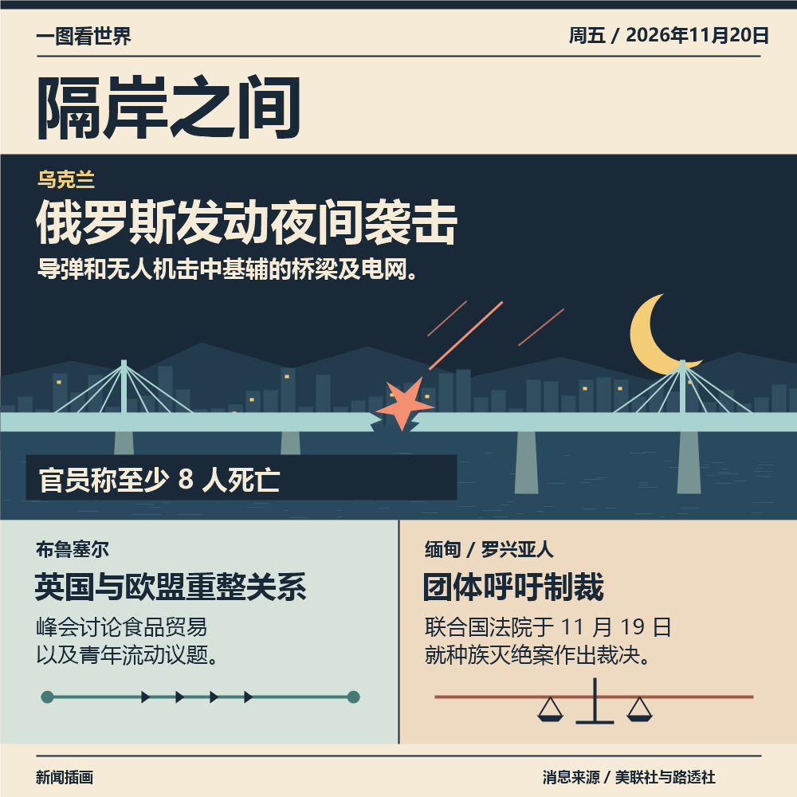

# 一图看世界 / World News · 20 November 2026

[中文](#中文) · [English](#english)

[中文版 / Chinese](entry.zh.png) · [English edition / 英文版](entry.png)

## 中文

### 第一次使用

1. 想做其他日期或今天的新闻图，请[打开每日新闻制图](https://xialin99.github.io/makefun-news-studio/)。选择日期，勾选新闻，再点 **下载 PNG**。
2. 想看这份参赛原稿，直接打开 [中文版](entry.zh.png) 或 [英文版](entry.png)。

2026 年 11 月 20 日世界新闻的单图排版，附生成脚本和最终 PNG。

### 本地运行

直接打开 [中文版](entry.zh.png) 或 [英文版](entry.png)。在 Windows PowerShell 7 中运行 `./draw.ps1` 生成中文版，添加 `-Language en` 生成英文版。

## English

### First use

1. To create a poster for today or another date, [open Daily News Studio](https://xialin99.github.io/makefun-news-studio/), pick a date, choose stories, and download the PNG.
2. To view this archived competition entry, open the [Chinese image](entry.zh.png) or the [English image](entry.png).

A one-image editorial summary of world news for 20 November 2026, with its renderer and resulting PNG.

### Run locally

Open the [Chinese edition](entry.zh.png) or the [English edition](entry.png). Run `./draw.ps1` in PowerShell 7 on Windows. Add `-Language en` to render the English edition.

[make.fun 赛事 / Original bounty](https://make.fun/bounty/news-image-20261120)

## 许可证 / License

MIT. See [LICENSE](LICENSE).

